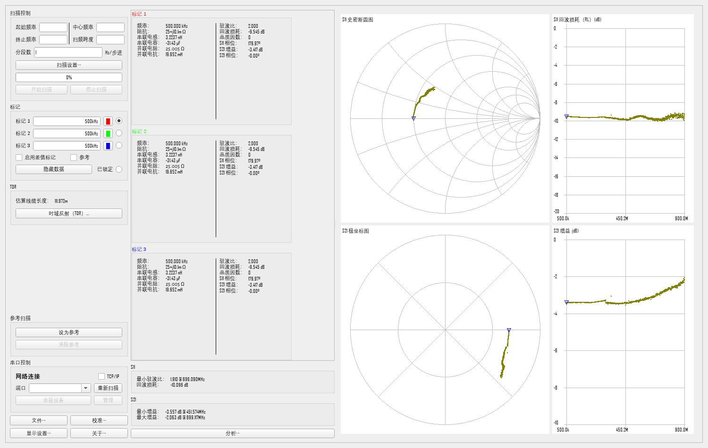

.. role:: raw-html-m2r(raw)
   :format: html

.. image:: https://img.shields.io/github/v/release/NanoVNA-Saver/nanovna-saver.svg
   :target: https://github.com/NanoVNA-Saver/nanovna-saver/releases/latest
   :alt: Latest Release

.. image:: https://img.shields.io/github/license/NanoVNA-Saver/nanovna-saver.svg
   :target: https://github.com/NanoVNA-Saver/nanovna-saver/blob/master/LICENSE.txt
   :alt: License

NanoVNASaver（简体中文版）
==========================

跨平台的 NanoVNA 上位机：从设备读取数据、分段扫描以获得更多数据点、
用多种图表显示和分析测量结果，并保存为标准 Touchstone 文件。

**本仓库是上游 NanoVNA-Saver 的简体中文分支**，界面已完整汉化（覆盖率 99.7%），
并在保留全部原有功能的前提下补充了中文文档与术语表。
英文原版说明见 `README.rst <README.rst>`_。

* 版权所有 2019, 2020 Rune B. Broberg
* 版权所有 2020 起 NanoVNA-Saver Authors

使用 **Python 3（>= 3.10）**，依赖 **PySide6**、**numpy**、**scipy**。

界面预览
--------

中文术语处理原则：缩写保留拉丁字母，SOLT 标准件译作短路 / 开路 / 负载 / 直通，
等等。详见 `docs/I18N_ZH.md <docs/I18N_ZH.md>`_。

简介
----

本软件连接 NanoVNA，将测量数据读入电脑显示，并可将扫描结果保存为
Touchstone 文件。

当前功能
--------

* 从 NanoVNA 读取数据 —— 支持 NanoVNA、NanoVNA-H、NanoVNA-H4、NanoVNA-F、
  AVNA（经 Teensy）、LiteVNA、SV4401A、SV6301A、JNCRadio VNA 3G
* 从 TinySA 读取数据
* 将频率范围切分为多段以提升分辨率（实测可超过 1 万点）
* 多次测量取平均，改善高频段的稳定性
* 以多种图表显示数据，包括史密斯圆图、对数幅度、相位、驻波比等，
  S11 与 S21 各自独立
* 显示标记点，并读出该处的阻抗、驻波比、Q 值、等效电容/电感等
* 可将自定义频段（例如业余频段）作为背景显示
* 导入与导出单端口、双端口 Touchstone 文件
* TDR（时域反射）功能，用于测量线缆长度并显示沿线阻抗
* 低通、高通、带通、带阻滤波器分析
* 同时显示当前迹线与参考迹线
* 支持多段扫描时的实时刷新
* 软件内校准，并支持非理想校准标准件的补偿
* 可自定义显示选项，含深色模式
* 可将图表导出为图片

安装
----

二进制发行版
^^^^^^^^^^^^

Windows 用户可直接使用发行页的打包程序，无需安装 Python：
https://github.com/NanoVNA-Saver/nanovna-saver/releases/latest

从源码运行
^^^^^^^^^^

需要 Python ≥ 3.10 与 `uv <https://docs.astral.sh/uv/>`_：

.. code-block:: bash

   uv sync                        # 安装依赖（含开发依赖）
   uv run task ui-compile         # 编译 Qt 资源，首次运行前必须执行
   uv run NanoVNASaver            # 启动

本分支默认中文界面，如需英文：

.. code-block:: bash

   uv run NanoVNASaver --lang en
   # 或设置环境变量 NANOVNA_LANG=en

界面语言与括注行为的更多说明见 `docs/I18N_ZH.md <docs/I18N_ZH.md>`_。

打包 Windows 单文件
^^^^^^^^^^^^^^^^^^^

.. code-block:: bash

   uv run task build-pkg-win      # 产物位于 dist/nanovna-saver.exe

其他安装方式见 `docs/INSTALLATION.md <docs/INSTALLATION.md>`_。

使用
----

将 NanoVNA 接到串口，在串口框中填入端口号；若在启动前已连接，程序会自动识别，
否则点击「重新扫描」。然后点「连接设备」。

程序支持多段采集以获得更精确的测量：在「分段数」中填入段数，每段 101 个数据点，
约需 1.5 秒。

频率以 Hz 输入，也可带 k 或 M 后缀，科学计数法（如 6.5e6）同样可用。

标记点可手动输入，也可用鼠标拖动：用单选按钮选中当前标记，或按住 Shift 点击
拖动最近的标记。标记读数框显示的是实际测量频率处的结果。

显示设置在「显示设置」中，可调整图表配色、字号以及显示哪些图表，设置会被保存。

校准
----

**使用 NanoVNA-Saver 前，请先确保设备本身处于合理的校准状态。**

在完整频率范围内对两个端口做一次校准并存入 0 号槽位即可。若设备完全未校准，
其读数可能超出本程序可接受的范围。

软件内校准可选「使用理想值」，也可填入标准件的实际参数。手动校准的步骤是：
依次扫描各标准件，然后按下校准窗口中对应的按钮。也可以用「校准向导」，
按提示逐步完成；可在备注栏记录校准条件。

校准结果与备注可一并保存和载入。

已知标称值的校准件，可录入其参数并保存为标准件组。

按下「应用」后，校准立即作用于最新的扫描数据。

TDR
---

要获得准确的 TDR 结果，请先校准设备，并把待测线缆接在**校准面**上——也就是
与校准负载相同的连接位置。打开「时域反射」窗口，选择线缆类型，或手动填写
速度因子。

测量磁环磁导率
--------------

用单端口测量即可测得磁环的磁导率（μ）。在已知尺寸的磁环上绕若干圈，
然后在「显示设置」中选择「S11 μ」图表。磁环的截面积（mm²）、有效磁长（mm）
与绕线圈数可在图表的右键菜单中设置。

本分支的改动
------------

相对上游，本分支只做界面与工程上的增补，不改动测量逻辑：

* 新增运行时翻译层 ``src/NanoVNASaver/i18n.py``，不侵入上游代码，
  合并上游更新时不会冲突
* 术语按国内习惯处理，缩写保留拉丁字母（S11、TDR、EFHW、dB、MHz 等）
* 在标题、分组框、按钮等宽敞处自动补英文缩写括注，如「回波损耗（RL）」
* 修复串口探测在异常时未关闭句柄、导致端口被占用的缺陷
* 新增 ``tools/`` 下的覆盖率审计、截图与探针脚本

详细说明与术语表见 `docs/I18N_ZH.md <docs/I18N_ZH.md>`_。

贡献
----

欢迎提交改进！请先阅读 `贡献指南 <docs/CONTRIBUTING.md>`_。

许可证
------

本项目使用 GNU 通用公共许可证第 3 版。**不提供任何担保。**

你可以将它用于商业用途，也可以修改代码；许可证要求你把修改回馈给社区。

参考
----

* Ohan Smit 撰写的使用入门：https://zs1sci.com/blog/nanovnasaver/
* HexAndFlex 的 NanoVNA 入门三篇，第三篇专门讲 NanoVNASaver：
  https://hexandflex.com/2019/08/31/getting-started-with-the-nanovna-part-1/
* Gunthard Kraus 编写的英、德文文档：http://www.gunthard-kraus.de/fertig_NanoVNA/

致谢
----

原程序作者 Rune B. Broberg（5Q5R）

贡献与修改：Holger Müller（DG5DBH）、David Hunt 等

TDR 思路来自 Salil（VU2CWA）：
https://nuclearrambo.com/wordpress/accurately-measuring-cable-length-with-nanovna/

TDR 线缆参数由 Larry Goga 提供。

缺陷修复与 Python 安装工作由 Ohan Smit 完成。

感谢所有测试、反馈与提供灵感的朋友，特别是忍受早期版本不稳定的内测组。
