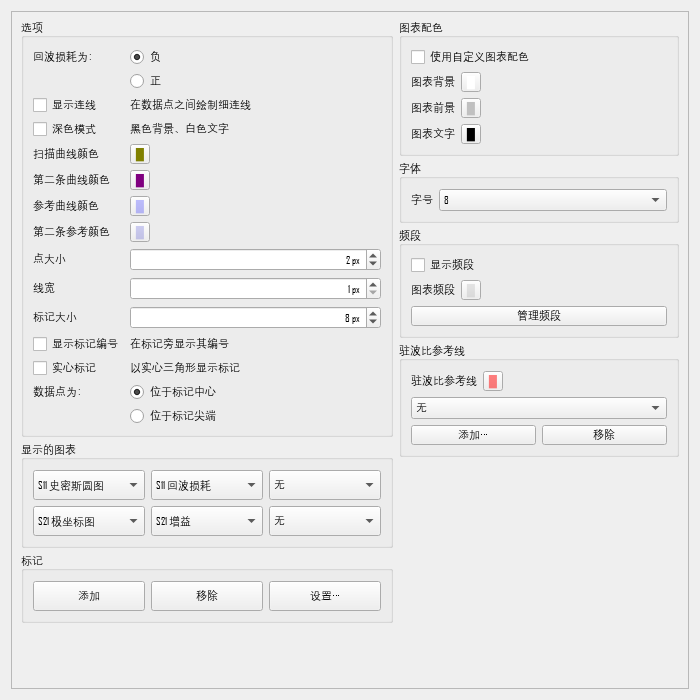
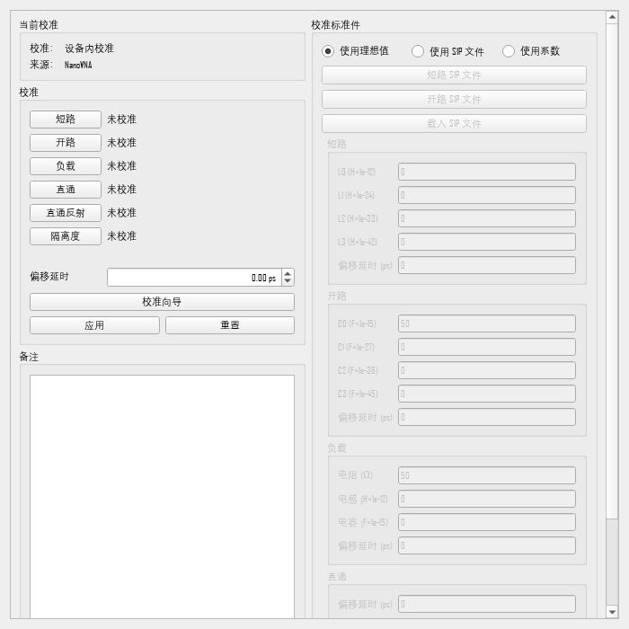
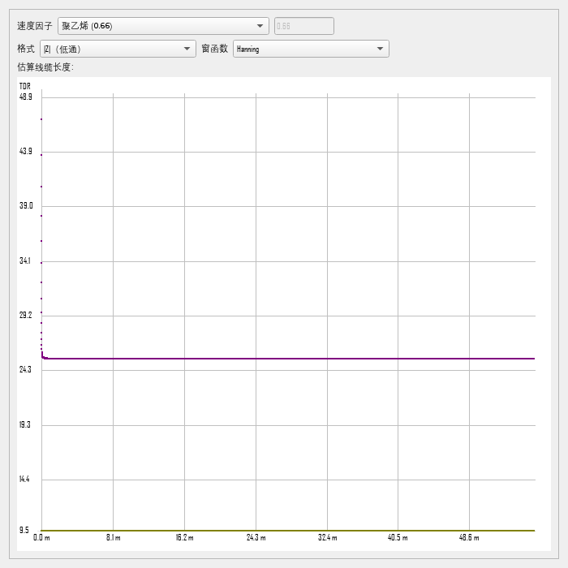

# 简体中文界面（i18n）

本 fork 在原版基础上加了一层中文界面，**不改动上游业务代码**。

- 实现：`src/NanoVNASaver/i18n.py`（本 fork 新增）
- 接入：`src/NanoVNASaver/__main__.py` 里 `i18n.install()`
- 语言切换：`NanoVNASaver --lang en` 或环境变量 `NANOVNA_LANG=en`（默认 `zh_CN`）

## 效果

| 主界面 | 显示设置 |
| --- | --- |
|  |  |

| 校准（SOLT 标准件） | 时域反射（TDR） |
| --- | --- |
|  |  |

截图均为无头渲染，字体走系统雅黑。

## 为什么不做 Qt Linguist（.ts/.qm）

上游 96 个模块里的界面文字全是**硬编码英文字面量**，`self.tr()` 调用数为 0，
直接上 `.ts` 需要改动上百个调用点，且每次合并上游都会冲突。

这里改成**运行时翻译代理**：在 Qt 控件类的文本 setter / 构造器上挂一层
包装，把英文映射成中文。未命中的字符串原样透传，因此：

- 上游升级零冲突（本文件是纯新增）
- 动态拼接的文本（含数值、文件名）不会被误改
- 可随时用 `--lang en` 回到英文

## 术语处理原则

**缩写一律保留拉丁字母**，只翻中文读者需要翻译的部分。

| 保留原文 | 理由 |
| --- | --- |
| `S11` `S21` `S12` `S22` | S 参数，国际通用 |
| `TDR` | 时域反射，行业标准缩写 |
| `EFHW` / `HWEF` | 天线型式缩写 |
| `dB` `dBm` `Hz/kHz/MHz/GHz` `Ω` `μ` `pF/nH` | 单位 |
| `Touchstone` `S1P` `S2P` `DB/MA/RI` | 文件格式名与格式关键字 |
| `NanoVNA` `LiteVNA` `SV4401A` `TinySA` `AVNA` | 产品型号 |
| `RG-58` `LMR-400` 等线缆型号 | 型号名，翻译反而查不到 |
| `Hanning` `Blackman` `Kaiser` | 窗函数名称 |
| `TCP/IP` | 协议名 |

**行业术语按国内习惯**：

| 原文 | 译名 | 说明 |
| --- | --- | --- |
| VSWR | 驻波比 | 国内 ham 通用 |
| Smith Chart | 史密斯圆图 | |
| Return Loss | 回波损耗 | |
| Short / Open / Load / Through | 短路 / 开路 / 负载 / 直通 | SOLT 四件套，**不要**把 Load 译成"载入" |
| Isolation | 隔离度 | |
| Group Delay | 群延时 | |
| Quality Factor | 品质因数 | |
| Permeability | 磁导率 | 测磁环用 |
| Velocity Factor | 速度因子 | 部分资料作"缩短系数" |
| Unwrap | 解卷绕 | 相位解卷绕 |
| Span / Center | 扫频跨度 / 中心频率 | 扫描控件里是频率 |
| Segment | 分段 | 分段拼接扫描 |
| Marker / Delta Marker | 标记 / 差值标记 | |

## 同词异义的坑

`Start`/`Stop`/`Load` 这类词在不同控件里含义完全不同，纯文本字典会翻错。
因此 `tr()` 支持**上下文键** `类名:原文`，优先于纯文本键：

```python
"QLabel:Start":      "起始频率",   # 扫描控件里的频率输入框
"QPushButton:Stop":  "停止扫描",   # 扫描按钮
"QGroupBox:Load":    "负载",       # 校准标准件
```

目前用到的上下文有 `QLabel` / `QPushButton` / `QGroupBox` / `QComboBox` /
`QFormLayout` / `QMessageBox` / `QFileDialog` / `QInputDialog`。

## 还有个身份标识问题

图表名（如 `S11 Smith Chart`）会**写进配置文件**并用于查找：

```ini
[General]
Chart00=S11 Smith Chart
```

所以 `Chart.name` 必须保持英文原值，只在下拉框显示和绘制时翻译。
写入配置时用 `i18n.untr()` 把中文译名还原成英文。改动见
`Windows/DisplaySettings.py`。

## 缩写括注

中文术语后面括注英文缩写，方便和仪器、数据手册、国外教程对照：

```
S11 回波损耗（RL）(dB)      ← 图表标题
时域反射（TDR）…            ← 按钮
驻波比（VSWR）              ← 分组框
```

但不是所有地方都加——标记读数那一列只有 110px 宽，加进去会把数值挤出去。
所以按控件类型区分：

| 加括注（宽敞处） | 不加（窄处） |
| --- | --- |
| 图表标题、分组框、按钮、菜单项、标签页、窗口标题、消息框、列表项 | 标记读数行、下拉框选项、表格列头、表单标签 |

用环境变量可以改：

```bash
NANOVNA_ABBR=all   # 到处都加（标记读数也会带）
NANOVNA_ABBR=off   # 完全不加
# 默认 title：只在标题/分组框/按钮这类地方加
```

匹配用的是**结尾匹配**：只有译名以术语结尾时才补括注，
所以「驻波比参考线」不会被拆成「驻波比（VSWR）参考线」。

当前词表（`i18n.py` 的 `_ABBR_PAIRS`）：

| 中文 | 缩写 |
| --- | --- |
| 驻波比 | VSWR |
| 时域反射 | TDR |
| 回波损耗 | RL |
| 群延时 | GD |
| 品质因数 | Q |
| 磁导率 | μ |

加词就往这个元组里加一行，顺序无关。

## 工具

```bash
# 统计翻译覆盖率（无头构建全部窗口，列出残留英文）
QT_QPA_PLATFORM=offscreen QT_QPA_FONTDIR="C:/Windows/Fonts" \
  uv run python tools/i18n_audit.py

# 从源码里提取所有待译字符串
uv run python tools/i18n_extract.py

# 渲染中文界面截图
QT_QPA_PLATFORM=offscreen QT_QPA_FONTDIR="C:/Windows/Fonts" \
  uv run python tools/i18n_shot.py
```

当前覆盖率：**99.7%**（唯一未译项是版本号字符串，属于数据不是界面文字）。


## 加新词条

1. 跑 `tools/i18n_audit.py`，看 `untranslated.txt` 里剩下什么
2. 在 `i18n.py` 的 `ZH` 字典里加条目；同词异义就加 `类名:原文` 形式的上下文键
3. 重跑审计确认覆盖率
